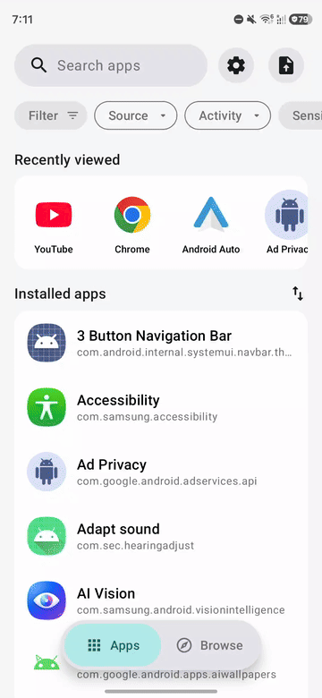
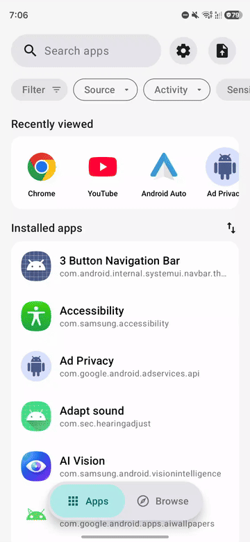
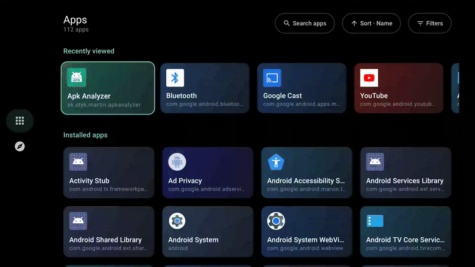
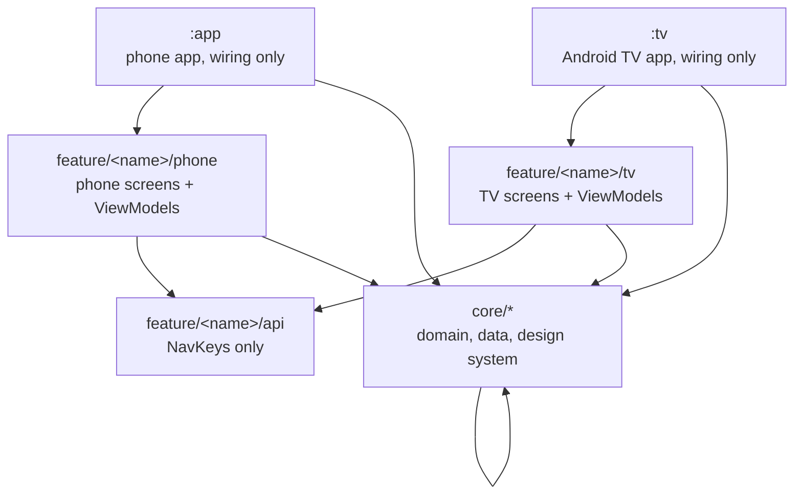

<div align="center">


# Apk Analyzer

**Everything Android knows about the apps on your phone or TV — no root, no ads, and your app data
stays on the device.**

[](https://github.com/MartinStyk/AndroidApkAnalyzer/actions/workflows/ci.yml)
[](https://github.com/MartinStyk/AndroidApkAnalyzer/actions/workflows/release.yml)
[](LICENSE)
[](gradle/libs.versions.toml)
[](build-logic/convention/src/main/kotlin/sk/styk/martin/apkanalyzer/utils/AndroidSdk.kt)
[](https://play.google.com/store/apps/details?id=sk.styk.martin.apkanalyzer)
[](CONTRIBUTING.md)

*The most downloaded APK analysis app on Google Play. Shipping since 2017, now rebuilt in Jetpack
Compose for phones, tablets, and Android TV.*

<a href='https://play.google.com/store/apps/details?id=sk.styk.martin.apkanalyzer'></a>

</div>

---

## See it in action

<p align="center">
  
  
  
</p>
<p align="center">
  <sub><b>App details</b></sub> &nbsp;&nbsp;&nbsp;&nbsp;
  <sub><b>Filter apps</b></sub> &nbsp;&nbsp;&nbsp;&nbsp;
  <sub><b>Browse apps</b></sub>
</p>

## Table of contents

- [What it does](#what-it-does)
- [On Android TV](#on-android-tv)
- [Why it exists](#why-it-exists)
- [Privacy and permissions](#privacy-and-permissions)
- [Requirements](#requirements)
- [Tech stack](#tech-stack)
- [Architecture](#architecture)
- [Getting started](#getting-started)
- [Repository layout](#repository-layout)
- [CI and releases](#ci-and-releases)
- [Documentation](#documentation)
- [Contributing](#contributing)
- [AI-assisted development](#ai-assisted-development)
- [Support](#support)
- [License](#license)

## What it does

- 🔎 **See what Android hides.** Every permission, certificate, component, and manifest flag, in
  plain language.
- 🔒 **On-device analysis.** App data never leaves your device — the AI summary runs locally too.
- 🧭 **Start from an attribute, not an app.** Which apps want this permission, share this signer,
  or target this Android version.
- 📺 **Phone and TV.** One Play listing, a dedicated interface for each.
- 🆓 **Free and open source.** No ads, no paywall on the raw data, GPLv3.

**One report per app, with everything Android knows about it.**

| Group | What you get |
|---|---|
| 🪪 Identity | Package and app name, version name and code, app category, install and update dates |
| 📶 Compatibility | Target and minimum Android version, required and optional hardware features |
| 🏬 Origin | The full install-source chain — which store or app actually installed it |
| 🔏 Signing | Certificate details, issuer and subject, validity, fingerprints, signing-scheme versions |
| 🔐 Permissions | Requested and declared permissions, with plain-language descriptions and protection levels |
| 🧩 Components | Activities, services, receivers, and providers, with intent filters, exported state, path permissions, and launch options |
| 📦 Packaging | Native libraries and ABIs, split APKs, shared UID group, manifest security flags, storage size |
| 📄 Manifest | The complete `AndroidManifest.xml`, formatted for reading |

**🧭 Browse by attribute.** Pick a permission, a signing certificate, an Android version, an install
source, a shared UID, or a category, and see every app that matches.

**📂 Analyze `.apk` files.** Open an `.apk` from another app or from storage and get the same full
report without installing it.

**🤖 On-device AI summary.** A short, factual read on what an app is and what its permissions and
components imply, generated locally with ML Kit's GenAI Prompt API.

**📤 Export and share.** Export or share the APK, save the app icon, copy or share a text summary,
and launch an app's components directly.

## On Android TV

📺 The same reports, built for the remote. The TV app lists, searches, and filters your installed
apps, opens the full report for any of them, and browses by every attribute the phone app does.
Install it from the same Play listing on any Android TV device.

Analyzing `.apk` files, the AI summary, and export and share are phone-only.

<p align="center">
  
</p>
<p align="center">
  <sub><b>Apk Analyzer on Android TV</b></sub>
</p>

<p align="center">
  
  
  
</p>
<p align="center">
  <sub><b>Installed apps</b></sub> &nbsp;&nbsp;&nbsp;&nbsp;
  <sub><b>App details</b></sub> &nbsp;&nbsp;&nbsp;&nbsp;
  <sub><b>Browse by attribute</b></sub>
</p>

## Why it exists

Android tells you very little about the software you already run. Apk Analyzer shows the full
manifest-level picture of every installed app in a form a person can read — no root, no ads. The
raw facts stay free by design; the [roadmap](docs/app/product/roadmap.md) covers where
interpretation features are heading.

## Privacy and permissions

App analysis runs entirely on the device. The phone and TV apps each declare two sensitive
permissions, both for the core feature:

| Permission | Why |
|---|---|
| `QUERY_ALL_PACKAGES` | Read the list and details of installed apps — the reason the app exists |
| `PACKAGE_USAGE_STATS` | Optional. Powers last-used times and storage breakdowns; you grant it in system settings |

The network is used only for Firebase telemetry (Analytics, Crashlytics, Performance) and for ML Kit
to download the on-device AI model. See [`PRIVACY_POLICY.MD`](PRIVACY_POLICY.MD).

## Requirements

Android 9 (API 28) or newer, on a phone, tablet, or Android TV. The AI summary also needs a phone
that supports on-device generative AI.

---

## Tech stack

| Layer | Choice |
|---|---|
| Language | Kotlin; coroutines and `Flow` for all async work |
| UI | Jetpack Compose only — Material 3 on phone, Compose for TV on TV, no XML layouts |
| DI | Hilt |
| Navigation | Navigation 3 (`androidx.navigation3`) |
| Persistence | Room, DataStore Preferences |
| On-device AI | ML Kit GenAI Prompt API |
| Images | Coil 3 |
| Build | Gradle version catalog and custom convention plugins (`build-logic/`) |
| Backend services | Firebase (Analytics, Crashlytics, Performance, App Distribution) |
| Static analysis | Spotless (ktlint + compose-rules-ktlint), Detekt, Android Lint, LeakCanary in debug |
| Min / target SDK | 28 / 37 |

Exact versions live only in [`gradle/libs.versions.toml`](gradle/libs.versions.toml); nothing pins a
version anywhere else.

## Architecture

A multi-module Gradle project where dependencies point one way. Each app — `app` for phones, `tv`
for Android TV — depends on its own feature modules, features depend on `api` and `core` modules,
and `core` never depends on a feature.



`feature/*/api` holds only NavKeys, so features navigate to each other without compiling against
each other's code. The phone and TV apps share every domain and data module in `core`; TV code never
touches `app`, a phone feature module, or Material 3, and has its own design system built on TV
Material.

Three shapes repeat everywhere, so an unfamiliar file is rarely a surprise:

- **ViewModels** expose a single `StateFlow<State>`, a single `onAction`, and one-shot `Event`s over
  a `Channel`.
- **Repositories** are a public `interface` plus an `internal Impl`; they never throw and take
  injected dispatchers.
- **UI** comes from a design system, never from Material components scattered across features.

Every module carries an `AGENTS.md` with its boundary and package map.

**Full details → [`docs/engineering/architecture.md`](docs/engineering/architecture.md)** —
dependency rules, module ownership, navigation, and each shape with production references.

## Getting started

**Prerequisites:** the latest stable Android Studio. Gradle provisions a matching JDK on the first
build, and Android Studio's SDK Manager covers the Android SDK. The
[`setup-local-tools`](.claude/skills/setup-local-tools/SKILL.md) skill covers headless setup and
optional tools.

```bash
git clone https://github.com/MartinStyk/AndroidApkAnalyzer.git
cd AndroidApkAnalyzer
./gradlew assembleDebug   # the first build downloads Gradle, the JDK, and all dependencies
```

`app/google-services.json` is committed, so the Firebase Gradle plugins build with nothing to
configure. CI swaps in a freshly fetched config at build time.

**Common tasks:**

```bash
./gradlew :app:installDebug     # install the phone app on a connected device or emulator
./gradlew :tv:installDebug      # install the TV app on a connected Android TV device or emulator
./gradlew spotlessApply         # fix formatting — run before every commit
./gradlew :feature:apps:phone:compileDebugKotlin   # fast single-module check while iterating
./gradlew spotlessCheck detektDebug :build-logic:convention:detektMain lintDebug :app:assembleDebug :tv:assembleDebug   # what CI gates on
./gradlew validateAgentContext  # check the shared Claude and Copilot context files
```

Version name and code come from Gradle properties (`-Pversion.name=`, `-Pversion.code=`) and default
to a local `dev` build.

Spotless fixes formatting, Detekt fails on warnings, Android Lint checks Android correctness, and
LeakCanary watches for leaks in debug builds. What each enforces — and the two problems no gate
catches — is in [`docs/engineering/verification.md`](docs/engineering/verification.md).

Writing code? The conventions — no comments, `Result` or nullable returns instead of exceptions,
injected dispatchers, private `MutableStateFlow` behind a read-only view, one combined screen state
— are in [`docs/engineering/coding-standards.md`](docs/engineering/coding-standards.md).

## Repository layout

```
app/           Phone app: Activities, nav host, app-scoped Hilt bindings — wiring only
tv/            Android TV app, shipped under the same application ID — wiring only
core/          Domain, data, and design-system modules
feature/       api, phone, and tv modules per feature area
build-logic/   Convention plugins; SDK levels and the JVM toolchain live here
config/        Detekt and static-analysis configuration
docs/          Product roadmap, feature designs, engineering docs, technical decision records
.claude/       Task skills shared by Claude and Copilot
gradle/        Version catalog and wrapper
```

## CI and releases

Every push and pull request to `develop` runs the checks and builds a debug APK; pushes also go to
internal testers. An annotated `MAJOR.MINOR.PATCH` tag builds and signs both apps, publishes one
GitHub release with both APKs, and uploads each app to its Play Store beta track. Promotion to
production is a separate manual step for the phone app, the TV app, or both, so a release reaches
only the apps it changes. Workflows, triggers, and secrets are in
[`docs/engineering/ci-and-release.md`](docs/engineering/ci-and-release.md).

## Documentation

**For users and anyone evaluating the app**

| Doc | What it covers |
|---|---|
| [`docs/app/product/roadmap.md`](docs/app/product/roadmap.md) | Open scope and sequencing, with stable IDs |
| [`docs/app/product/shipped.md`](docs/app/product/shipped.md) | What has shipped or been deliberately retired, and why |
| [`docs/app/product/features/`](docs/app/product/README.md) | One design doc per feature, written before it's built |
| [`PRIVACY_POLICY.MD`](PRIVACY_POLICY.MD) | What leaves the device, and what doesn't |

**For contributors and technical reviewers**

| Doc | What it covers |
|---|---|
| [`CONTRIBUTING.md`](CONTRIBUTING.md) | How to propose, build, and submit a change |
| [`AGENTS.md`](AGENTS.md) | The canonical engineering rules — humans and agents read this first |
| [`docs/engineering/architecture.md`](docs/engineering/architecture.md) | Module graph, dependency rules, module ownership, the three repeating shapes |
| [`docs/engineering/coding-standards.md`](docs/engineering/coding-standards.md) | Conventions to know before writing code, with examples from the codebase |
| [`docs/engineering/verification.md`](docs/engineering/verification.md) | Spotless, Detekt, Lint, LeakCanary — what each enforces and what gates CI |
| [`docs/engineering/ai-workflow.md`](docs/engineering/ai-workflow.md) | Per-module `AGENTS.md`, `validateAgentContext`, and the shared skills |
| [`docs/engineering/ci-and-release.md`](docs/engineering/ci-and-release.md) | The GitHub Actions workflows, the release pipeline, and promotion to production |
| [`docs/app/technical/`](docs/app/technical/README.md) | Cross-cutting engineering decisions and audits |
| [`.claude/skills/`](.claude/skills) | Step-by-step procedures for recurring tasks, shared by Claude and Copilot |

---

## Contributing

Contributions are welcome. Start with [`CONTRIBUTING.md`](CONTRIBUTING.md) for the workflow, then
[`docs/engineering/architecture.md`](docs/engineering/architecture.md) and
[`docs/engineering/coding-standards.md`](docs/engineering/coding-standards.md) for module boundaries
and conventions. By taking part you agree to the [Code of Conduct](CODE_OF_CONDUCT.md).

Good first contributions: a **translation** — the phone app ships in 19 languages, the TV screens are
still English-only, and a pull request that touches only `strings.xml` files needs no prior
discussion — or anything marked open in the [roadmap](docs/app/product/roadmap.md).

## AI-assisted development

Claude and GitHub Copilot both work on this codebase from the same `AGENTS.md` context files and the
shared `.claude/skills/`. Details → [`docs/engineering/ai-workflow.md`](docs/engineering/ai-workflow.md).

## Support

* **Bugs and feature requests** — [open an issue](https://github.com/MartinStyk/AndroidApkAnalyzer/issues)
* **Security vulnerabilities** — see [`SECURITY.md`](SECURITY.md); please don't file a public issue
* **Using the app** — leave reviews and general feedback on the
  [Play Store listing](https://play.google.com/store/apps/details?id=sk.styk.martin.apkanalyzer)

## License

Licensed under the [GNU General Public License v3.0](LICENSE).
