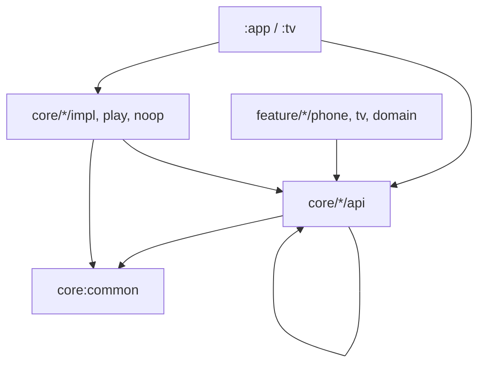

# Core API/Impl Split and Entitlements

**Status:** Proposed. Nothing is built yet. `core:entitlements` is the first module with this shape;
existing core domain modules move to it one at a time afterwards.
**Scope:** How a core domain module splits into an `api` and an implementation module, where models,
resources, and top-level functions go, how the split is enforced, and how `core:entitlements` swaps
its Google Play Billing implementation for a no-op one per build type. Does not cover the
entitlement product design: what is paid, pricing, or the purchase UI.

## Why

* Google Play Billing has to be optional. Release builds ship without it for now, so every consumer
  of entitlements must compile against a contract and never against the billing implementation.
* Today the only boundary inside a core module is `internal`. A split makes it structural: a feature
  cannot reach an implementation class because the module isn't on its classpath.
* It mirrors `feature/*/api`, which already lets features depend on each other's contract only.

## Module Shape

| Module | Holds |
|---|---|
| `core/<name>/api` | Public interfaces, models, constants, pure extensions on those models, model labels |
| `core/<name>/impl` | The implementation: `Impl` classes, Hilt bindings, workers, Room, platform access |

A domain with more than one implementation names each module after what it is instead of `impl`:

| Module | Holds |
|---|---|
| `core/entitlements/api` | `EntitlementsRepository` and the entitlement models |
| `core/entitlements/play` | The Google Play Billing implementation; the only module with the billing library |
| `core/entitlements/noop` | Grants every entitlement and offers nothing for sale |

Packages and namespaces follow the existing directory rule: `core.entitlements.api`,
`core.entitlements.play`, `core.apps.api`, `core.apps.impl`. Each module therefore has its own `R`
class.

### Which modules split

Domain modules with a contract that features consume split: `apps`, `app-permissions`, `app-index`,
`app-history`, `app-export`, `apk-files`, `ai-insights`, `user-preferences`, and the new
`entitlements`.

These stay single modules:

* `design-system` — a UI toolkit, not a domain. There is no second implementation of a button.
* `common` — dispatchers, logging, and shared primitives at the bottom of the graph.
* `navigation` — infrastructure the app shells and feature entry providers call directly.
* `app-functions` — only `app` depends on it. It is already an implementation; it depends on other
  modules' `api`.

## What Goes Where

### `api`

* Public interfaces for repositories and managers. Interface methods still never throw.
* Models: `@Serializable` data classes, sealed interfaces, enums.
* Constants consumers need, in an `object`.
* Pure top-level extensions on `api` models that need no dependency, no `Context`, and could never
  have a second implementation — they define what the model means. Today's examples in `core:apps`:
  `isLaunchable`, `hasUnguardedPathPermission`, `isExternallyReachableWithoutPermission`.
* `testFixtures` with a fake for every interface, so feature and domain tests never depend on an
  implementation module.

`api` never contains Hilt modules, `@Inject` classes, Compose, or platform access. It is still an
Android library, because it may own resources (see below).

### Implementation

* The `Impl` classes, the `@Module @InstallIn(SingletonComponent::class)` binding interface, workers,
  Room databases, `PackageManager` and other platform access.
* Logic that is injected — evaluators, mappers, policies — is an interface in `api` and a class in the
  implementation. The "logic lives in classes, not objects" rule is unchanged; the class just moves
  behind an interface.
* **Everything is `internal`.** Nothing outside the app shells ever sees this module, so a public
  declaration here is always a mistake.
* Unit tests for the implementation live here.

### Resources

A string lives in the lowest module that needs it:

* **Labels and explanations for `api` models go in `api`**, together with their `@StringRes`
  extensions. `ComponentFlag.labelRes`, `exportedExplanationRes`, and
  `RequirementItem.availabilityExplanationRes()` in `core:apps` are this kind. Both implementations and every feature share them, so they are part of
  the contract.
* **Strings only the implementation uses go in the implementation module**, such as notification
  titles or worker channel names.
* **Feature copy currently parked in a core module moves to the feature.** `core:apps` today holds
  screen copy such as `app_detail_sdk_version` and `app_info_unavailable`, which `feature:app-detail`
  reads through `AppsR`. Splitting a module is the point at which this is sorted out. When the phone
  and TV modules both need the same copy, follow the existing rule for shared feature logic.

Moving a string between modules moves it in every `values-<locale>/strings.xml` as well; the
`translate-strings` skill covers keeping locale key sets aligned.

### Top-level functions and objects

| Shape | Goes in |
|---|---|
| Pure extension or predicate on `api` models | `api` |
| `@StringRes` mapping for an `api` model | `api`, with the strings |
| Constants a consumer needs | `api` |
| Anything needing `Context`, `PackageManager`, I/O, or a dependency | implementation, behind an `api` interface |
| Constants only the implementation uses | implementation, `internal` |

## Dependency Rules



* An `api` module depends only on other `core/*/api` modules and `core:common`.
* An implementation depends on its own `api` and on other modules' `api`, never on another
  implementation.
* Only `app`, `tv`, and `app:baselineprofile` depend on implementation modules.
* Features and feature `domain` modules depend on `api` only.

## Entitlements Wiring

The app shells pick the implementation per build type. Debug ships Google Play Billing, release
ships the no-op:

```kotlin
dependencies {
    implementation(projects.core.entitlements.api)
    debugImplementation(projects.core.entitlements.play)
    releaseImplementation(projects.core.entitlements.noop)
}
```

`tv` uses the same three lines. Switching release to Play Billing later is a one-line change in each
shell.

* Hilt fails to compile a variant with no `EntitlementsRepository` binding, so a missing or duplicate
  implementation cannot ship silently.
* The baseline profile plugin adds its own `nonMinifiedRelease` and `benchmarkRelease` build types.
  Check that they resolve the no-op; if they don't inherit `releaseImplementation`, declare the no-op
  for them explicitly.
* `noop` grants every entitlement and exposes no offers. Purchase UI derives from the offers, so it
  disappears on its own in release without a separate "billing enabled" flag.
* `play` maps every billing failure, including `BILLING_UNAVAILABLE` on a sideloaded debug build,
  to a state or a `Result`. It never throws, following the existing interface rule.

### Contract sketch

The product design decides the actual entitlements. The shape to keep:

* One `Flow` of what the user currently has access to, so a paid feature checks access from a single
  source rather than each screen asking billing on its own.
* One `Flow` of the offers that can be bought; empty in `noop`.
* A purchase call. Play Billing needs an `Activity` to launch its flow. How that reaches the
  repository without a ViewModel holding an `Activity` is an open question below.

## Enforcement

* **Convention plugins.** `apkanalyzer.core.api` configures an Android library with serialization
  and `testFixtures`, and no Hilt or Compose. `apkanalyzer.core.impl` adds Hilt. Each module applies
  one or the other, never both.
* **`validateArchitecture`.** New checks for the dependency rules above: an `api` module only on
  `api` modules and `core:common`; nothing but the app shells on an implementation module; an
  `api` module never applies the Hilt plugin.
* **A detekt rule in `build-logic/detekt-rules`.** Built: `ImplModuleVisibility` reports any public
  top-level declaration in a nested core module other than `api` and `design-system`, so every new
  implementation module (`impl`, `play`, `noop`) is covered without a config change.
* **`core/<name>/AGENTS.md`** stays one file per domain, covering both submodules, the same way
  `feature/<name>/AGENTS.md` and `core/design-system/AGENTS.md` already cover theirs.

## Migration

1. Build `core:entitlements` with this shape. It is new, so nothing moves.
2. Add the convention plugins and the `validateArchitecture` and detekt checks, scoped to modules
   that have split.
3. Migrate existing modules one at a time, smallest consumer surface first: `user-preferences`,
   `app-permissions`, `app-index`, `apk-files`, `ai-insights`, `app-export`, `app-history`, then
   `apps` last — it is the largest and carries the most feature copy in its strings.

Migrating one module means: create `api`, move interfaces, models, labels, and pure extensions into
it, rename the remaining module to `impl` and make it `internal`, repoint consumers' imports and
dependencies to `api`, and add the `impl` dependency to the app shells.

## Open Questions

* **Purchase handoff.** Play Billing's purchase flow needs an `Activity`. The likely shape is a
  ViewModel event the screen handles, calling the repository with the `Activity` it already has;
  confirm when the purchase UI is designed.
* **A billing-free public build.** If a build without billing is ever distributed, for example on
  F-Droid, build types stop being enough and the app shells move to product flavors. Nothing in the
  module shape changes; only the wiring does.
